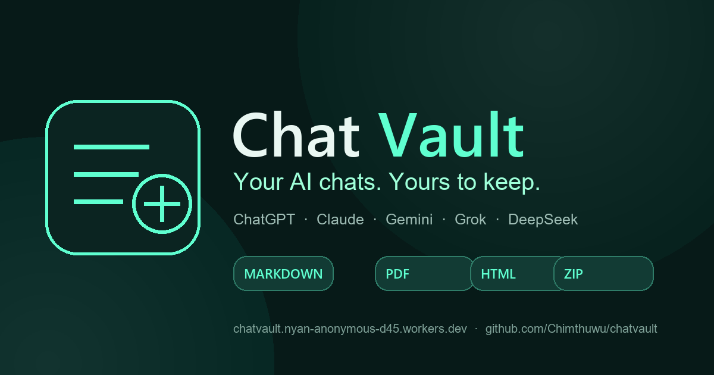
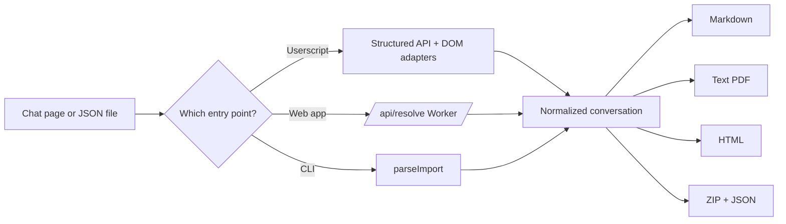

<div align="center">

```
 ██████╗██╗  ██╗██╗   ██╗██████╗ ███████╗██╗   ██╗███████╗██████╗ 
██╔════╝██║  ██║██║   ██║██╔══██╗██╔════╝██║   ██║██╔════╝██╔══██╗
██║     ███████║██║   ██║██████╔╝█████╗  ██║   ██║█████╗  ██████╔╝
██║     ██╔══██║██║   ██║██╔══██╗██╔══╝  ██║   ██║██╔══╝  ██╔══██╗
╚██████╗██║  ██║╚██████╔╝██║  ██║███████╗╚██████╔╝███████╗██║  ██║
 ╚═════╝╚═╝  ╚═╝ ╚═════╝ ╚═╝  ╚═╝╚══════╝ ╚═════╝ ╚══════╝╚═╝  ╚═╝
```

# ChatVault

**Your AI chats. Yours to keep.**

One-click export for ChatGPT, Claude, Gemini, Grok, DeepSeek, Perplexity and Copilot — to Markdown, PDF, HTML and ZIP. No account, no API key, no external conversion service.

[](https://chatvault.nyan-anonymous-d45.workers.dev)
[](tests/)
[](LICENSE)
[](package.json)



</div>

---

## Why

Chat conversations vanish behind logins, UI redesigns and broken "copy" buttons. ChatVault turns them into files you own:

- **Markdown** — headings, code fences, tables, links, timestamps, roles.
- **PDF** — a real, text-selectable document generated locally (no jsPDF, no server).
- **Print-perfect PDF** — opens a styled HTML view and the browser's print dialog.
- **HTML archive** — a self-contained, readable copy.
- **ZIP** — all four above in one tidy bundle.
- **JSON** — the normalized conversation for your own tooling.

## Three ways in

### 1. Web app (no install)

👉 **https://chatvault.nyan-anonymous-d45.workers.dev**

Paste a public share URL, a platform JSON export, or a plain transcript (`You: …` / `Assistant: …`). Pick a download. JSON and text modes never leave your browser; only public share URLs go through the Worker.

### 2. Tampermonkey userscript

Grab [`userscripts/chatvault.user.js`](userscripts/chatvault.user.js), create a new Tampermonkey script, paste the whole file, save, and refresh your chat tab. A small `MD / PDF / PRINT / HTML / ZIP` toolbar appears in the corner.

For ChatGPT it first reads the structured backend conversation (the path that successfully exported a full 12-message thread), then falls back to rendered DOM. Every other platform uses layered DOM selectors plus a generic alternating-role fallback.

> The userscript is generated — edit `site/core.js`, `site/archive.js`, `site/extract-browser.js` or `userscripts/chatvault-main.js`, then run `npm run build:userscript`. Never hand-edit the `.user.js` file.

### 3. Hermes skill + CLI

Install the bundled [`skills/chatvault/SKILL.md`](skills/chatvault/SKILL.md), then ask Hermes to export a chat. Under the hood it calls the zero-dependency CLI:

```bash
node scripts/cli.mjs --input examples/sample-conversation.json --out ./my-chat
# → my-chat/<title>.md, .pdf, .html, .json, .zip
```

The CLI also reads ChatGPT `conversations.json`, Claude `chat_messages`, and generic `[{ "role": "user", "content": "…" }]` arrays.

## Platform support

| Platform | Structured extraction | DOM fallback | Public share URL via web app |
|---|---|---|---|
| ChatGPT (`/c/…`, `/share/…`) | ✅ backend conversation payload | ✅ | ✅ |
| Claude | — | ✅ | ✅ |
| Gemini / g.co | — | ✅ | ✅ |
| Grok / X | — | ✅ | share patterns are best-effort |
| DeepSeek | — | ✅ | ✅ (`/s/…`) |
| Perplexity | — | ✅ | ✅ (`/search/…`) |
| Copilot | — | ✅ | ✅ (`/chat/…`) |
| Anything else | — | generic heuristic | paste JSON / transcript |

## How it works



The shared model and exporters live in [`site/core.js`](site/core.js) and [`site/archive.js`](site/archive.js). The browser adapters live in [`site/extract-browser.js`](site/extract-browser.js); the Worker reads public share pages in [`src/worker/`](src/worker/). One codebase, identical output in all three products.

## Worker API

| Endpoint | Method | Purpose |
|---|---|---|
| `/api/health` | GET | Liveness + version |
| `/api/config` | GET | Supported platforms and limits |
| `/api/resolve` | POST `{url}` | Fetch a public share and return a normalized conversation |
| `/api/export/markdown` | POST `{conversation}` | Markdown file |
| `/api/export/html` | POST `{conversation}` | HTML file |
| `/api/export/json` | POST `{conversation}` | JSON file |

Only https public share URLs on the allowlisted hosts are fetched. Private `/c/` links, credentials in URLs, redirects off-host and oversized bodies are rejected.

## Development

```bash
npm test                 # builds the userscript + runs 16 node:test checks
npm run dev              # wrangler dev (local Worker + site)
npm run deploy           # wrangler deploy
npm run build:og         # regenerate the 1200x630 embed image (Pillow)
npm run cli -- --help    # local conversion CLI
```

## Honest limitations

- Server-side share retrieval is best-effort: platforms can block datacenter requests or render content purely client-side. When that happens, use paste-JSON mode or the userscript on the open chat.
- DOM selectors follow current layouts; they are the first thing to break when a platform ships a redesign. The generic fallback reduces total failures but cannot guarantee perfect role detection.
- The text PDF uses standard Helvetica with WinAnsi encoding: non-Latin characters are transliterated (`→` becomes `->`) and images are omitted. Use **Print-perfect** for full styling and Unicode.
- `/backend-api/*` on ChatGPT is an undocumented implementation detail, not a supported export API. It may change without notice.
- No conversation content is logged or stored by the Worker; rate limiting is in-memory and per-isolate.

## Layout

```
site/                 static web app + shared core/archive/extract modules
src/worker/           Cloudflare Worker API
userscripts/          generated self-contained userscript
templates/            userscript metadata header
scripts/              build, CLI, OG-image generator
skills/chatvault/     Hermes skill
tests/                node:test suite
examples/             sample conversation JSON
```

## License

MIT — see [LICENSE](LICENSE). Built for chat hoarders (◕‿◕).
